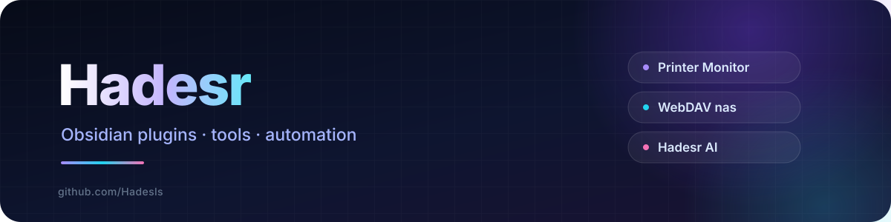

  

### I am Hadesr.

---

## Obsidian 插件

| 插件 | 说明 | 版本 / 状态 |
|---|---|---|
| **[MD Base64](https://github.com/Hadesls/MDbase64)** | 把当前笔记导出成图片内联的单文件 Markdown，原笔记不动 | `v1.1.2` · [已上架](https://community.obsidian.md/plugins/mdbase) |
| **[WebDAV nas](https://github.com/Hadesls/Webdav-nas)** | 轻量 WebDAV 同步：只上传 / 只下载 / 双向，桌面与移动端通用 | `v2.7.1` · [已上架](https://community.obsidian.md/plugins/webdav-nas) |
| **[Hadesr AI](https://github.com/Hadesls/Hadesr-obai)** | 选中即改写、行内补全（Tab 采纳），16 个动作 + AI 对话 | `v0.53.0` |
| **[CodeUI-Ob](https://github.com/Hadesls/CodeUI-Ob)** | Obsidian 代码块 / 表格 / 主题 UI 增强：Hadesr Code + Hadesr UI | `v2.26.0` / 主题 `v1.5.0` |

---

## 其他项目

| 项目 | 说明 |
|---|---|
| **[Printer-Monitor](https://github.com/Hadesls/Printer-Monitor)** | 打印机 SNMP 实时监控：墨粉 / 纸张 / 卡纸 / 离线告警，Web 面板集中管理 |
| **[Autoncm](https://github.com/Hadesls/Autoncm)** | 网易云 NCM 转 MP3 / FLAC 的图形化工具（Python + Flet） |

---

## 技术栈

---

  <a href="https://www.hadesr.com">https://www.hadesr.com</a>

